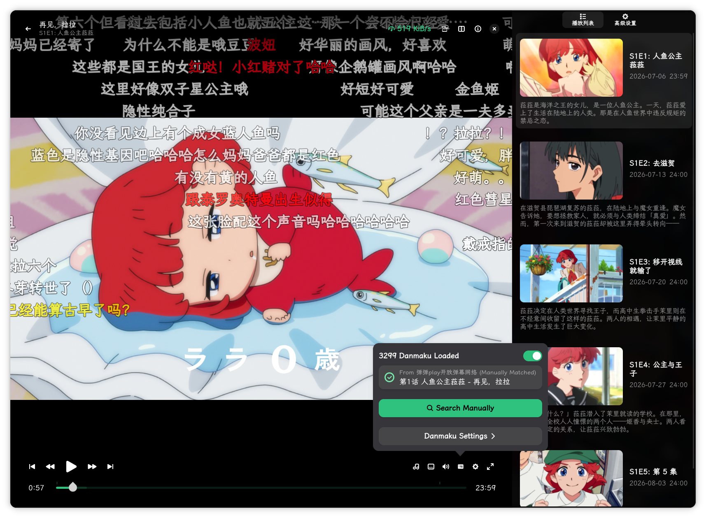

# RDplayer

> 基于 GTK4 / libadwaita 的第三方 Jellyfin / Emby 客户端（由 tsukimi 改造），视频使用 MPV、音乐使用 GStreamer。



## 特性

- 🎬 **Jellyfin / Emby 客户端**：浏览与播放媒体库，支持继续观看、剧集管理。
- 📺 **MPV 视频播放**：硬件解码、字幕、音轨、播放速度等完整控制。
- 🎵 **GStreamer 音乐播放**：后台播放与 Mpris 媒体控制。
- 💬 **自定义弹幕（Danmaku）服务器**：支持兼容 DandanPlay API 的自建 danmu_api 服务器。
  在设置中填写服务器地址（默认 `http://192.168.5.7:9321/87654321`），并按文件名自动选择番剧来源与集数
  （来源优先级 `tencent > iqiyi > youku > 306`，集数从如 `我不是大师S01E17` 的文件名解析）。
- 🌐 多语言界面（gettext）、自适应浅色 / 深色主题、强调色自定义。

## 安装

### Arch / CachyOS（推荐）

```bash
git clone https://github.com/rdevils7/tsukimi-danmaku.git
cd tsukimi-danmaku
./install.sh          # 自动用 pacman 安装依赖并以 makepkg -si 构建安装
```

或手动构建打包：

```bash
makepkg -si
```

### 从源码构建

```bash
meson setup build --prefix=/usr
meson compile -C build
sudo meson install -C build
```

> 依赖：rust、cargo、meson、blueprint-compiler、gtk4、libadwaita、mpv、glycin、
> gstreamer（含 gst-plugins-base / gst-plugins-bad）、openssl、dbus、libepoxy。

### Flatpak

见 `flatpak/moe.tsuna.tsukimi.yml`（需将源码地址改为你自己的 fork 后构建）。

## 配置弹幕服务器

启动后在弹幕设置中填入你的 danmu_api 地址（默认 `http://192.168.5.7:9321/87654321`）。
支持自动按来源优先级与文件名集数自动选集。

## 许可证

GPL-3.0-or-later。本项目基于 [tsukimi](https://github.com/tsukinaha/tsukimi)（上游作者 Inaha）改造。
